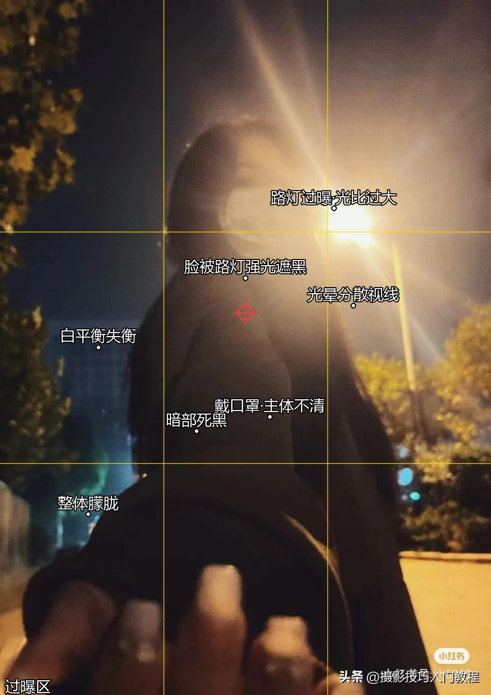

# PhotoJudge（摄判官）— 照片点评 / 诊断引擎

> 输入一张照片，输出一份"看得懂、改得动"的结构化诊断报告。
> 开源、可解释、可配置——帮你把"照片哪里不对"说清楚。


**PhotoJudge（摄判官）** 是一个照片诊断引擎：上传照片，自动按 **构图 / 曝光 / 对焦清晰度 / 色彩白平衡 / 内容主体 / 后期建议** 六个维度打分，给出可解释的评分、按影响排序的问题清单、可执行的修改建议，并把问题直接**标注在原图上**。

它不是黑盒打分，每个扣分点都写清"为什么 + 怎么改"；规则库完全开源，可自行适配不同摄影流派。

---

## 快速开始

### 方式一：作为 Skill 使用（推荐）

把本项目当作一个 Skill 引入你的 Agent，然后只需：

1. 上传一张照片；
2. （可选）说明拍摄题材 `portrait / landscape / food / street / pet / selfie / other` 与用途；
3. 获得诊断报告（JSON / Markdown）+ 标注图。

### 方式二：本地命令行跑打分引擎

```bash
cd engine
python score.py --demo                 # 运行内置示例（8.6/10）
python score.py vision-input.json --output report.json   # 用你的判据跑
python annotate.py 原图.jpg --annotations report.json --output 标注图.jpg
```

依赖：Python 3、Pillow（标注用）。规则加载器零第三方依赖。

### 多张照片（批量）

一次上传多张（≥2），每张独立诊断，外加一张排行表：哪张最好、每张最该改哪个问题、共同短板在哪。契约见 `docs/report-batch-schema.json`。

---

## 它能做什么

- **六维诊断**：构图 / 曝光 / 对焦清晰度 / 色彩白平衡 / 内容主体 / 后期建议。
- **0–10 可解释评分**：每个扣分点给"为什么 + 怎么改"，题材自适应权重（人像/风光/其他）。
- **问题直接标在图上**：三分线、主体位置、过曝区、以及**问题文字标注**（白字细黑边，随图自适应字号）。
- **按影响排序的问题清单** + 可执行修改动作。
- **分设备后期方案**：手机（醒图/VSCO/LR 移动端）、电脑（LR/PS）双口径。
- **忠于原图**：标注只叠加显示，不重绘、不改原图像素。

## 核心差异化

1. **可解释**：每个评分给理由和改法，不是黑盒打分。
2. **可执行**：输出是"具体动作"，用户能照着改。
3. **规则开源 + 权重可配置**：`rules/` 全开源，可适配不同摄影流派。
4. **题材自适应**：人像、风光等评分侧重不同。
5. **可本地自部署**：全流程可本地跑，照片不离开你的设备。

---

## 示例输出（真实效果）

下面两张是引擎的真实产出：问题直接标注在原图上，白字细黑边、随图自适应字号、忠于原图不重绘。



*夜景背光差照（7.3/10）：过曝、人脸被路灯强光遮黑、暗部死黑等问题直接标注在图上。*

> 想自己跑一遍？`cd engine && python score.py --demo` 即可复现报告与标注图。

---

## 目录结构

```
PhotoJudge/
├── SKILL.md            # skill 主文档（定位/触发/输入输出/六维框架）
├── README.md           # 本文件
├── LICENSE             # MIT
├── CONTRIBUTING.md     # 贡献指南
├── SECURITY.md         # 安全说明
├── CHANGELOG.md        # 版本记录
├── CODE_OF_CONDUCT.md  # 行为准则
├── rules/              # 六维打分规则（72 条）+ 冲突说明 + 索引/权重
├── engine/             # 打分引擎（load_rules.py + score.py + annotate.py）
├── examples/           # 示例输入 / 输出（可直接参考）
├── output/             # 诊断报告 Markdown 模板
└── docs/               # 架构、引擎规范、报告 schema（单图+批量）、发布流程
```

## 规则与依据

规则来自四类公开来源交叉综合（详见 `摄影六维打分规则依据库.md`）：

- 业内通识 / 教学体系（构图、曝光、用光）
- Adobe LR / PS 官方教程（后期参数口径）
- 佳能 / 索尼官方教学（参数-场景对应）
- 面向大众的拍摄方法（含部分"一方称"经验，标注为参考建议而非硬扣分）

每条规则标注**来源与证据等级**（已查证 / 通识 / 一方称），冲突点如实分列待确认。

## 开发进度

- [x] 产品框架定稿（六维、题材权重默认值、输出结构、硬约束）
- [x] 填充 `rules/` 六维规则（72 条）
- [x] 冲突收敛（7 处收敛，K6 并入规则条目）
- [x] 定义 JSON schema 与 Markdown 双格式输出（含批量）
- [x] 打分引擎可运行（`engine/score.py`）
- [x] 图像标注能力（问题文字标注、白字细黑边）
- [ ] 视觉分析层实例化（模型多模态读照片产出 vision input）
- [ ] CI / 单元测试 / 文档站点
- [ ] v1.0 正式发布

## 贡献

欢迎提交 Issue、PR 或新规则。请先读 [CONTRIBUTING.md](CONTRIBUTING.md)。发现安全漏洞请按 [SECURITY.md](SECURITY.md) 处理，勿公开披露。

## License

本项目以 **MIT License** 开源（[LICENSE](LICENSE)），可自由使用、修改、商用，仅需保留版权声明；按现状（AS IS）提供，作者不承担责任。

> PhotoJudge 规则库提炼自公开教程要点，尊重书籍与官方教程版权，只提炼要点与操作口径，不做原文复制。
